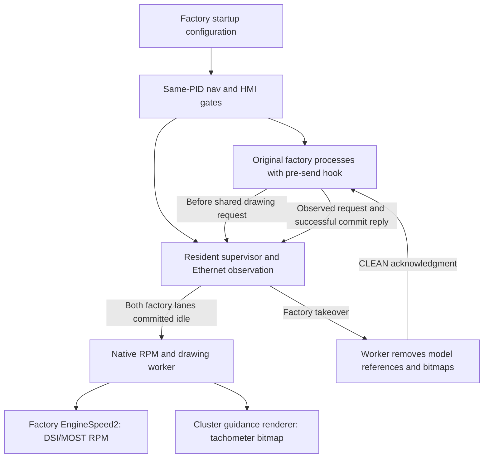

# How the installed tachometer works

Read [verified status](../APP-STATUS.md) for evidence limits. This describes the persistent implementation accepted on NBTevo_T24081I, not the earlier DSI prototype.

## Runtime flow

The receiver is the cluster's Ethernet guidance service at the measured endpoint `160.48.199.96:30502`, not a local head-unit framebuffer. The app uses SOME/IP service `0xb006`, shared guidance instance `200`, client ID `0x5348`. Factory radio/list service is `0xb00e`, instance `100`. These values are implementation assumptions for this target, not vehicle-discovery results for any future installation.

## Startup and process ownership

`tools/persistent_boot_gate.c` is compiled twice. Factory startup launches the corresponding gate, which ultimately `execv`s the original navigation or HMI program in the same PID with its arguments. It preserves the factory supervision arrangement rather than manually replacing a supervised process.

When enabled or armed for one boot, the gates arrange one resident process and wait up to about two seconds for its capture/broker readiness. They preload `libsupra-navigation-handoff-experimental.so` into the factory programs. The HMI gate preserves exactly `libEGL_X.gpp.so:libGLESv2_X_FORWARD.gpp.so:libKD_X.gpp.so`; the resident child does not inherit that graphics preload. An unknown inherited preload or invalid activation prerequisites falls back to the original factory program without adding the hook.

The release lives in `/var/opt/supra-hud/v1`; boot-local state lives in `/tmp/supra-hud-v1`. An `armed` token is consumed once and shared by both gates through a RAM boot marker. `enabled` permits future boots; `disabled` takes precedence. A consumed trial is not automatically rearmed.

## Admission and factory priority

`tools/supra_resident.cpp` combines the pre-send hook's events with actual Ethernet requests/replies using `src/factory_lease.*` and `src/factory_stream.*`. Both navigation and radio start **Unknown**. Mere silence, a 30-second delay, or an open socket is insufficient to permit drawing.

Navigation idle is a successful commit of the reviewed main guidance visibility model (`0x21000000`, state 0). Radio idle is a successful commit of the reviewed list-control model (`101`, focus `0xffffffff`). Both must be committed idle with no pending non-background requests. The resident also waits at least 30 seconds from its own startup and coalesces factory activity for 200 ms. These delays never manufacture ownership.

The hook handles navigation's `TWeakPtr` and HMI's `std::weak_ptr` adapter ABIs. It sends a bounded copy of relevant pre-send data to the resident before the factory send. The factory adapter completes the SOME/IP length later; comparison normalizes that field in a private copy only. Observed outgoing bytes and correlated successful replies still have to match.

Before allowing a takeover or unrecognized factory request, the resident asks the worker to withdraw and expects `CLEAN`. The hook waits at most about three seconds, then gives factory traffic priority even if cleanup was uncertain. Therefore it is incorrect to promise factory traffic can never overlap an unremoved image after a failure. Uncertain cleanup is reported as failure and prevents automatic drawing retries.

Narrowly classified RoadInfo/text background requests can proceed without withdrawal only after exact normalized bytes are preauthorized by the worker. This is bounded TCP-aware matching, not a port-wide exemption.

After factory guidance stops or radio focus clears and the corresponding commits are observed, a new worker starts. The individual worker reports `automatic_resume:false`; automatic return belongs to the **resident**, not to that child process.

## Live RPM and display

The installed worker is built with `SUPRA_FACTORY_RPM`. `src/factory_rpm.cpp` uses `MOSTSubSystem.DSYSMOSTServer` 4.5, Vehicle FBlock 05/00, EngineSpeed2 function `0x0cd0`, registry provider `0x5000`. It polls read-only GET at most every 100 ms with a serialized sender and accepts correctly addressed two-byte big-endian quarter-RPM status values in 0..7700. The drawing loop targets roughly 250 ms updates; acquired samples must advance and be no older than 200 ms, with 300 ms render freshness. The old diagnostic gateway path remains for explicit research probes/host fixtures; it is not the installed persistent RPM feed.

`src/hud_core.*` computes segment/shift state. `src/tach_bitmap.cpp` produces opaque BGRA pixels for a 150 × 36 sport layout, including 20-pixel-high digits, 24 bar segments and five steady lights. Full scale is 7000; the shift sequence begins at 80% of 6500 (5200) and reaches five lights at 6500. At simulated 5500 the owner saw one orange, at 6200 three orange and one red, and at 6500 five red. The native wire encoder applies the measured red/blue mapping at the display boundary; white-only tests would not reveal a wrong mapping.

The worker loads an `SHP1` profile: ten setup and seven cleanup commands. Symbol removal comes from the verified **empty high-guiding union plus maneuver direction 0**, keeping the coming-road bitmap reference. Direction 0 alone is not documented as a universal blank-symbol command.

Before drawing, only the two tach slots `0x01000008` and `0x01000009` must be absent. Factory slots 0..7 may remain populated; the worker never creates or removes those resources. Shared-model factory admission is still required. It uploads/checks the next RLE32 image, changes the coming-road reference with method 14, then removes/checks the previous image. It does not recreate the full guidance graph on each frame; that is what eliminated the flashing. Upload is method 3, presence check method 2, removal method 8. Replies must match the exact request correlation fields.

## Cleanup and failure behavior

Normal handoff withdraws the profile's model references and removes owned bitmaps, checking absence before acknowledging CLEAN. The worker never disposes the shared factory instance. It does not clear arbitrary factory graphics.

The worker also passively observes factory traffic. If factory drawing has already begun, capture becomes unreliable, or drawing I/O is uncertain, it stops issuing shared-state cleanup commands rather than overwrite factory state. That can leave graphics/resources unresolved; a restart and inspection may be needed. A locally exited process is not proof of removal.

The supervisor checks child results and retains the first fault. Known RPM transport failures are retryable only after verified clean removal: 1/2/4-second backoff, then one attempt per 30 seconds after repeated clean input failure in the accepted startup repair; 30 seconds of stable worker lifetime resets that counter. On the Gold baseline, exhausting clean RPM retries also wrote persistent `disabled`. The accepted repair remains alive for rate-limited clean input recovery. A closed factory connection ends the current boot only without persistent disable when withdrawal is proven clean. Clean zero-frame owned-slot contention retries with the same 1/2/4/30-second backoff and unchanged factory admission. Unexpected exits are classified separately from cleanup uncertainty. Other uncertain exits still quarantine the app and write `disabled`. See [cold-start repair scope](V1-COLD-START.md). Drawing ACK allowance is 500 ms; reply correlation and 300 ms RPM freshness remain enforced. A worker rejects a missing/old supervisor heartbeat (1500 ms). This is not a cluster-side guaranteed image expiry mechanism.

Logs are bounded: the active worker journal rotates around 1 MiB, startup capture is capped around 2 MiB, and hook tracing is bounded around 64 KiB. RAM evidence may be replaced by another boot/worker. Persistent `fault-first.json` and four `fault-recent-N.json` files retain bounded exit details, stderr and final journals. Writes are synced and atomically published; repeated identical recoverable events are throttled. See [fault recording](PERSISTENT-FAULT-RECORDS.md).

## Source map

| File | Responsibility |
| --- | --- |
| `tools/persistent_boot_gate.c`, `tools/persistent_state.c` | Factory-preserving startup and activation tokens |
| `tools/prepare_persistent.py`, `tools/persistent_install.py` | Exact-image kit and staged installation/rollback |
| `tools/supra_resident.cpp` | Admission, child lifetime, capture, return and quarantine |
| `tools/navigation_handoff_hook.cpp` | Bounded pre-send notification for both factory ABIs |
| `src/factory_lease.*`, `src/factory_stream.*` | Visibility commit correlation and TCP reassembly |
| `tools/supra_standalone.cpp` | RPM, drawing loop, cooperative stop and cleanup |
| `src/standalone_wire.*` | Profile validation, SOME/IP, RLE32, bitmap operations |
| `src/tach_bitmap.*`, `src/hud_core.*` | Pixels and display rules |
| `src/native_backend.*`, `src/native_session.*`, registry/DSI tools | Earlier prototype/research; not the installed rendering path |
