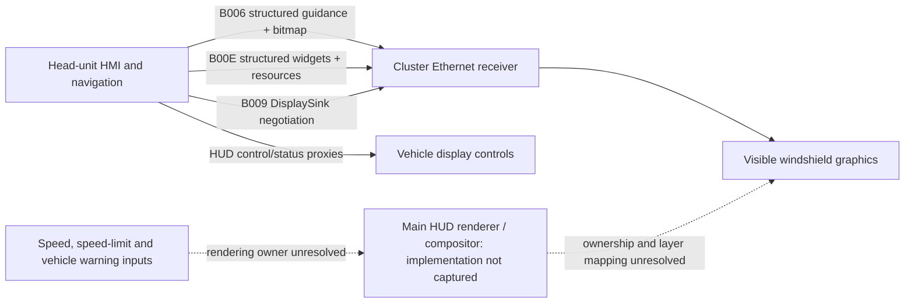

# Whole-windshield capability map for V2

19 November 2026. Scope is the entire HUD rendering system, not only B00E. This is an evidence map, not a claim that every renderer has been recovered. Installed V1 is unchanged. No Hz tests belong in the next canvas session.

## Ownership and composition

B006/B00E terminate at the measured cluster endpoint; their visibility in the windshield is demonstrated. This does not identify every downstream ECU or prove that the cluster itself composites every pixel. None of the captured HU-side Screen/LayerManager/WFD surfaces is established as the root windshield framebuffer. An image fitting inside a factory widget is not access to the main surface.

## Drawing capabilities and evidence

| Region/interface | What is established | What we can currently draw | Dimensions/placement and remaining gap |
|---|---|---|---|
| Main windshield surface | Speed, limits, warning graphics and widgets visibly coexist | No arbitrary root-surface drawing API established | Full resolution, origin, clipping, layers, receiver implementation and access remain unresolved |
| B006 guidance road image | V1 and cross/IU seen in windshield and cluster; removal verified | Arbitrary opaque RLE32 image in proven road-image slot | 150×36 tested; factory positioning; no free x/y or z-order demonstrated |
| B00E Carousel | Factory source menu renders in windshield; exact restoration verified | Producer-backed candidates for two content cells; not yet visually verified | Bitmap ceiling 128×128; 36/64/96/128 tests prepared; actual scaling/clipping unknown |
| B00E Entertainment | Station list captured; factory allocator can supply bitmap IDs to content cells | Exact table codec and bounded content-cell runner prepared; not yet visually verified | Same instance bitmap ceiling; explicit row/column, no guessed selection metadata |
| B00E voice | Captured model and focus/withdrawal; factory graphic observed | No verified custom bitmap binding | Zero advertised inherited dimension pair is not zero visible area |
| Phone/call models | Factory phone widget observed, structured model captured | No verified custom bitmap-producing field | Geometry/receiver rules unknown; no fabricated image sender |
| Warning/door B011 | 81×81 PNG retrieval travels cluster→HU | No upload canvas from that exchange | Asset retrieval is separate from warning composition and placement |
| Speed/speed-limit | Factory display and named input proxies present | No image injection path established | Input values are not evidence of a head-unit pixel stream |
| Height/alignment outline | Broad factory outline observed and recorded | No custom binding | Outline is not proof of accessible dimensions or an app-owned surface |
| B009/PiP | Factory selection 460×237/1 and completion captured | Prior custom PiP attempts produced only arrows, not marker pixels | Pixel-to-receiver job/session binding unresolved; not a working larger surface |
| HU Screen/LayerManager | Local windows, native buffers, output-driver artifacts captured | Local rendering is technically distinct | Local window size does not establish windshield resolution or destination |

## Main HUD control trace added in this pass

Captured HmiMain3D SHA `fe770d1957fdfcd250d1f8cf7fba0e9a7c25e8c053e59f04f3274055fedda935` contains named `CPxyHUDInterface` and three child proxy vtables:

- `CControlHUD2`: vtable `0x39c0ec8`, child offset `+0x6c4`.
- `CStatusHUD2`: vtable `0x39c0e80`, child offset `+0x730`.
- `CControlHUD2KOMBI`: vtable `0x39c0e38`, child offset `+0x7b4`.

Constructor `0x22ea5e4` and initializer `0x22ea564` correlate those children with registration values `0x410`, `0x411`, `0x415`, respectively. These are code-level registration values; this work does not assert they are a verified live MOST route or safe command IDs for another vehicle. The control routines at `0x22ea070` and `0x22ea1a8` serialize bounded scalar arguments, while status dispatch at `0x22ea268` parses bounded scalar fields. No pixel pointer, surface dimensions, image array or root-layer API is established in these routines. The symbolic name HUDInterface must not be mistaken for a drawing API.

This narrows the main-surface investigation: trace these control callers and the receiving component separately from B00E. Matching receiver code/firmware is not identified among the current artifacts. Absence from captured HU files does not prove no such interface exists.

## V2 design decisions supported now

- Keep the installed V1 implementation untouched. V2's existing 150×36 renderer is the only visually verified arbitrary-image area.
- Treat Carousel and Entertainment as two separate widget-layout experiments with bitmap-producing code paths, not two acquired canvases.
- Do not design a production fullscreen layout, fixed pixel coordinates or arbitrary overlay priority until measured.
- Preserve the owner photos privately. Their broad rounded empty frame supports a factory-container interpretation; it does not prove uploaded pixels are rendered.
- Record width/height limits separately from visible extent, aspect ratio, scaling, clipping, color, transparency, display destination and factory priority.

See [the concrete next-session matrix](NEXT-CANVAS-SESSION.md) and [the producer-to-content trace](B00E-CONTENT-BINDING.md). The main surface remains an explicit research target, not omitted or declared inaccessible.
