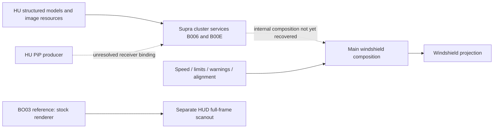

# Receiver root scanout: reference implementation and Supra boundary

19 November 2026. Offline source inspection only; installed V1 unchanged. No Hz tests, firmware execution, emulator execution or vehicle commands.

## Concrete receiver implementation

Credit **agent00jackson**, [bimmulator at bf03f2eed11969c1450a64fe5ba301a5ed128257](https://github.com/agent00jackson/bimmulator/tree/bf03f2eed11969c1450a64fe5ba301a5ed128257). Its Capricorn-M implementation models a **Bosch BO03 6WB** receiver with separate cluster and HUD scanouts. This supplies inspectable root-renderer architecture, but is **not an identified match for the Supra receiver**.

Source: `nix/patches/capricorn-m/0001-add-capricorn-m-machine.patch`, function `capricorn_gdc_scanout` (patch lines 1001–1058), RIF translation (144–177), and separate output instantiation (1159–1160). These are patch-file line numbers at the pinned revision.

| Root-scanout component | What the source actually does | What this does not establish |
|---|---|---|
| Output identity | Instantiates distinct `cluster` and `hud` graphics controllers | Supra controller addresses or display IDs |
| Geometry | Reads width from bits 16–27, height from bits 0–10 of layer-size register; reads pitch separately | A 4095×2047 usable HUD; these are field widths, not a tested resolution |
| Admission | Requires layer enable, panel enable, nonzero dimensions, pitch ≥ width and supported format | An externally callable drawing API |
| Framebuffer binding | Translates layer-start through a matching RIF mapping into backing graphics memory | A B009 job/session or B00E resource binding |
| Memory representation | Four-byte logical aperture slots map to packed three-byte memory; rows advance by pitch × 3 | The format accepted by our SOME/IP bitmap upload |
| Pixel decoding | Packed six-bit alpha, blue, green, red; expands each color and multiplies by alpha | Supra receiver pixel format or permission to write receiver RAM |
| Presentation | Resizes an emulator output and copies the decoded full frame | Windshield optical dimensions, safe overlay area, warp or crop limits |

This is a full-frame path, not a menu cell. It demonstrates how stock receiver graphics can share a final scanout without exposing that framebuffer to a head-unit application. The visible height-adjustment rectangle alone therefore does not establish an arbitrary-image canvas contract.

## Identity gate and transport gap

The reference firmware helper requires BO03 version `007_003_005`, program SWFL `00003e5b`, config `00003e5c`, and graphics `00003e5d`, with exact hashes. The reference probe uses MIPS64el QEMU. Our head-unit binaries are QNX ARM; they are a different component and cannot supply a receiver match merely because both vehicles use NBT Evo.

The reference README explicitly separates its shared-RAM speed/RPM fixture from native MOST delivery, which still needs network-master behavior and Kombi registration. Its successful emulated HUD therefore does **not** solve our head-unit-to-windshield pixel transport. Do not port its addresses, RAM readiness patches, or register writes to the Supra.

The retained TCP service audit contains B001 method `0x8004` notifications (342 across the deduplicated corpus), not an identified receiver firmware inventory. No receiver identity is inferred from that service number. Saved head-unit software identity remains insufficient to select matching receiver firmware.

## Whole-surface capability boundary

Solid arrows involving Supra represent observed output relationships, not recovered internal function calls. The BO03 reference is a separate architecture example, not a proven implementation of the Supra path.

The capability map must keep four measurements separate: **upload capacity**, **widget clipping bounds**, **root framebuffer geometry**, and **optically visible/safe area**. The prepared content-cell batch measures only the first two. It cannot establish the last two by increasing a bitmap size.

## Exact remaining receiver questions

1. Identify the actual Supra receiver implementation and its root output owner from existing evidence or matching source; do not assume BO03 compatibility.
2. Trace the receiving B006/B00E resource lookup into composition and the receiving B009 session/job lookup into a texture. Locate the common root target, if one exists.
3. Establish native dimensions, pitch, crop, coordinate origin, transforms and layer priority from that target—not photo pixels or advertised upload bounds.
4. Identify an application-reachable create/bind/update/remove contract. Root access is not ready for a live test without that contract and a restoration path.

The next live batch remains canvas-only, with no Hz work. B006 control and corrected B00E content bindings are executable widget cases. A main-root write is deliberately **not represented as ready**. No new car visit is requested by this source review.
