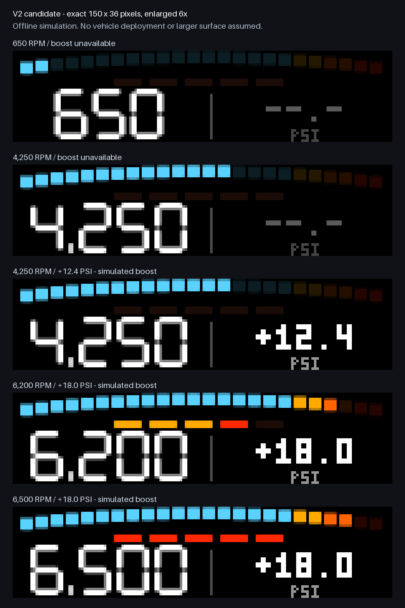

# V2 UX development

Branch: `v2-ux`, recut from the current V1 baseline (`v1-baseline-2026-11-18`). The installed repaired V1 is the exact preservation/return baseline; the original Gold tag remains historical and unchanged. V2 is a built, audited bounded car-test candidate, not installed or accepted on the car. See [the exact test and V1 recovery procedure](V2-CAR-TEST.md).

## Design direction

The owner supplied [this reference](design/v2-reference.png): a curved segmented cyan-to-orange/red tachometer, five centered shift lights, white RPM and signed PSI values, subtle labels and a divider. The first implementation keeps the proven **150 × 36** canvas, shared-session protocol, and V1 factory-priority contract.



These are actual C++ pixel outputs enlarged with nearest-neighbor scaling, not a photograph or projected-HUD proof. The reference has much more resolution and a taller aspect ratio; its glow, typography and proportions cannot be reproduced literally in the current canvas. The current candidate prioritizes the tach bar and shift lights: segments are 8 pixels tall (previously 4.75), and each shift indicator is 18 × 5 (previously 11 × 3). RPM digits are reduced from 20 to 14 pixels; the compact PSI readout remains 10 pixels. Unit labels sit beside the readouts. Rounded upright seven-segment RPM strokes and arc/shift-light edges use 4-by-4 coverage sampling into the same opaque native pixels; this adds edge shades, not display resolution. Inactive arc segments remain dim; the lit amount follows RPM.

The cyan/orange/red palette is canonical BGRA. The existing measured red/blue boundary correction still applies in the transport. V2's cyan projection and tiny labels must be judged on the actual windshield; offline appearance does not prove readability.

## What is implemented

- `tachBitmapV2(Frame)` in `src/tach_bitmap.cpp`, leaving classic/sport output unchanged.
- Bounded 150 × 36 opaque pixel output; no geometry, session or resource-ID changes.
- Comma-grouped RPM, central shift cues and signed one-decimal PSI display.
- Unavailable/non-finite/out-of-range boost renders `--.-`, not zero or invented telemetry.
- Demo-only `v2` selection with optional explicitly synthetic PSI.
- Reproducible preview generator and native renderer checks.

The default persistent mode **still selects V1 sport**. Explicit bounded V2 modes now select this renderer, with pressure reads only in the experimental boost mode. Existing saved DME pressure replies support a candidate decoder, not a calibrated boost gauge. A displayed simulated PSI value is not evidence of a live boost source. See [pressure evidence and test limits](V2-CAR-TEST.md#what-we-know-about-pressure).

## Reproduce offline

From the repository root, with a C++ compiler and Python/Pillow:

```sh
mkdir -p build
c++ -std=c++98 -Wall -Wextra -Werror -Isrc \
  src/hud_core.cpp src/tach_bitmap.cpp tools/tach_bitmap_demo.cpp \
  -o build/tach-bitmap-demo

# Unknown boost: dashes.
build/tach-bitmap-demo 4250 build/v2-rpm.bgra v2

# Synthetic display value only; does not read or command a vehicle.
build/tach-bitmap-demo 4250 build/v2-simulated-boost.bgra v2 12.4
python3 tools/render_v2_preview.py build/tach-bitmap-demo build/v2-preview.png
```

The demo's accepted PSI range (-30 to +60) is a formatting bound, not a vehicle operating limit. Existing 7000 RPM scale and 6500 shift cue remain display settings, not newly validated engine limits.

## Development order

1. **Current space:** refine readability, visual balance, arc shape and color progression offline. Review native-size/enlarged previews before a parked comparison. Preserve the V1 output and Gold Master tag.
2. **Live integration:** add explicit renderer selection, build/audit the QNX candidate and validate bounded draw/cleanup before considering a persistent change. Keep the proven double-buffer update and pre-send factory handoff. No full-graph rebuild per frame.
3. **Boost:** identify and verify a fresh pressure source and units/reference. The worker now has an opt-in candidate acquisition path using DIDs 4205/4201, and the core calculates candidate gauge PSI from paired absolute/ambient kPa. Do not label absolute pressure as boost or restamp stale data. Test missing/stale-source behavior and maintain RPM timing. Until then use dashes for actual operation.
4. **Larger space:** first review the existing captured geometry/model evidence and receiver limits offline. Define one explicit bounded geometry candidate, exact image binding, absence/cleanup checks and rollback. A larger bitmap upload alone does not prove a larger visible surface or windshield-only routing. Validate dimensions, clipping, both displays and factory handoff separately from telemetry changes.

Do not request another broad discovery trip merely to redraw pixels. A future car session should have exact candidates, expected visual differences and removal checks prepared ahead of time. The existing canvas is the first deliverable; expansion is not presumed successful.

## Initial verification

- Native bitmap tests pass under address/undefined-behavior sanitizers, including hidden/invalid clearing, opaque geometry, missing/invalid boost and isolation of boost changes to the right readout.
- Twelve classic/sport outputs at 650/4250/5500/6200/6500/7700 RPM match the Gold Master byte-for-byte.
- Five preview frames pass the corrected RLE32 encode/decode round-trip.
- Invalid demo RPM/PSI and PSI supplied to a non-V2 style are rejected.
- All 244 Python regression tests pass in the prepared environment with `pyelftools`.
- A QNX ARM candidate builds and passes the target-runtime static audit. No execution of this V2 build on the car, calibrated positive-boost accuracy or larger-surface proof is claimed.
